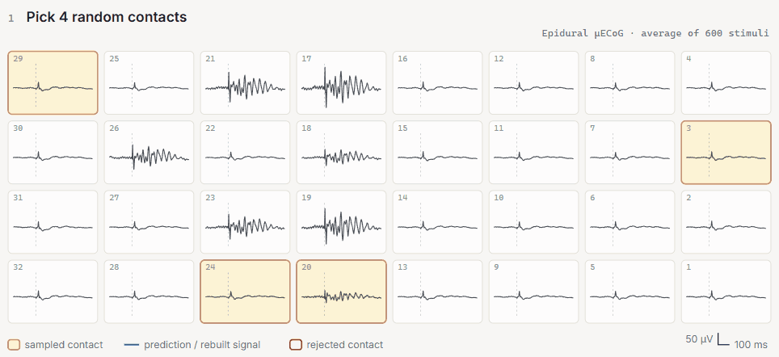
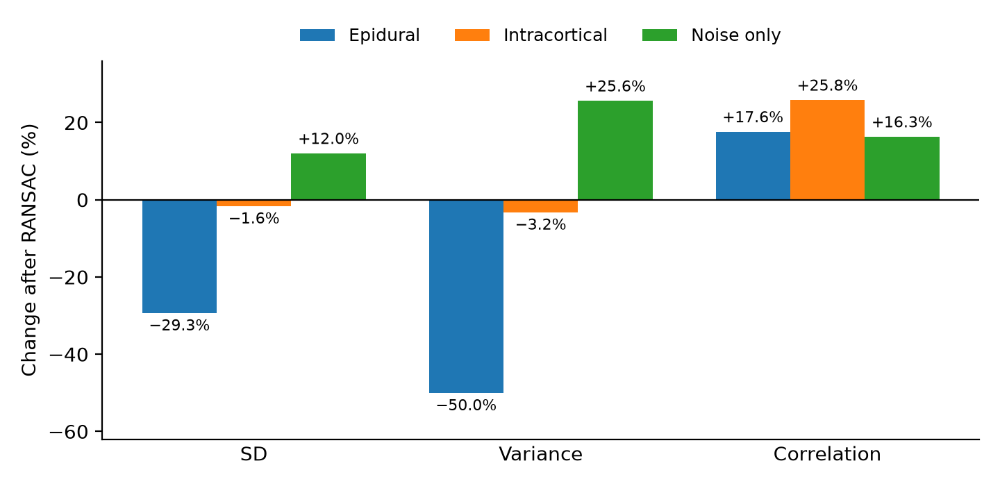

# Signal Reconstruction with RANSAC

[](https://nicaja.github.io/RANSAC-Intracranial-Recordings/)

*RANSAC on the epidural grid. The [interactive version](https://nicaja.github.io/RANSAC-Intracranial-Recordings/) also has the intracortical and noise-only recordings.*

We tested how well RANSAC detects and interpolates bad channels in high-density epidural micro-ECoG and intracortical microelectrode-array recordings. It predicts each channel from the others, so it relies on neighbouring contacts recording similar signals.

**Completed research project · IEEE EMBC 2025**

## Publication

**Strengths & Weaknesses of RANSAC applied to Epidural & Intracortical Recordings**

Nickolaj Ajay Atchuthan, Felipe Rettore Andreis, Winnie Jensen, and Suzan Meijs.

[Read the paper on IEEE Xplore](https://ieeexplore.ieee.org/document/11252752) · [DOI](https://doi.org/10.1109/EMBC58623.2025.11252752)

## What we found

The recordings come from anaesthetised pigs, with responses in the primary somatosensory cortex evoked by ulnar nerve stimulation. The epidural ones used a 32-contact 8 × 4 µECoG grid on the dura (setup as in [Meijs et al., 2024](https://doi.org/10.1109/EMBC53108.2024.10782109)), and the intracortical ones a 16-channel 4 × 4 microelectrode array with shafts 1 mm apart, inserted 2 mm into the cortex ([Janjua et al., 2021](https://doi.org/10.1016/j.ibneur.2021.08.004)). We compared an epidural, an intracortical and a noise-only example with MNE and autoreject, looking at waveforms, spatial maps, variance and correlation before and after RANSAC.

- Our tuned settings improved the epidural example: RANSAC rejected and rebuilt 8 of its 32 contacts, the variance halved and the correlation rose from 0.85 to 1.00.
- The same settings attenuated the intracortical signal. With autoreject's defaults the variance barely changed, but most rebuilt contacts came back with larger peaks that line up in time.
- The noise-only example became more correlated too (0.86 to 1.00), so correlation alone does not show that a reconstruction worked.



*From Table II of the paper. Each example is a single recording.*

RANSAC needs to be evaluated separately for each type of array. Penetrating arrays pick up local activity, which can break the spatial assumptions that suit the more correlated surface recordings. Any evaluation should look at the signal as well as the noise.

## Interactive figures

The [interactive page](https://nicaja.github.io/RANSAC-Intracranial-Recordings/) sketches the two arrays and walks through RANSAC on each example. In autoreject, RANSAC draws `n_resample` random subsets of `min_channels` × N contacts, predicts every contact from each subset by spherical-spline interpolation and takes the median prediction. A contact whose uncentred correlation with that median falls below `min_corr` is bad for that epoch. Contacts bad in more than 40% of epochs (`unbroken_time`) are rejected and rebuilt with MNE's `interpolate_bads`.

We digitised the traces from the vector paths of the paper's figures. `docs/traces/build_data.py` maps every path back to seconds and microvolts using the figure axes, and assigns it to its electrode through MNE's spatial colours and the recorded montage. No recording is reanalysed. Steps 1–4 are replayed on the averaged response with a distance-weighted interpolation in place of autoreject's spherical splines, so their numbers are illustrative. Step 5 uses the paper's bad-epoch log (rasterised, so approximate) and step 6 shows the paper's RANSAC output. The original figure PDFs and their provenance are in [docs/figures](docs/figures/).

## Code and supporting material

| Path | Role |
| --- | --- |
| `research/ransac_comparison.py` | Runs RANSAC with the paper's settings and reports SD, variance and correlation before and after |
| `preprocessing_ECoG/` | Historical preprocessing, RANSAC comparisons and spatial mapping |
| `preprocessing_MEA/bad_channel_detection/` | Intracortical RANSAC and channel-quality experiments |
| `general/` | Recording-loading helpers |
| `docs/` | Interactive figures served by GitHub Pages |
| `docs/traces/` | Traces digitised from the paper's figures, with the script that builds them |
| `docs/figures/` | Paper figures, reported values and provenance |

`research/ransac_comparison.py` takes preprocessed MNE epochs with every channel typed as `eeg` and a checked montage. It does no filtering, rescaling or channel remapping of its own. The `epidural-paper` preset is our tuned setting from Table I (`n_resample=7`, `min_channels=0.125`, `min_corr=0.85`, `unbroken_time=0.4`); `default` keeps autoreject's defaults, which we used for the intracortical data.

```sh
python -m pip install -r requirements.txt
python -m research.ransac_comparison --help
python -m research.ransac_comparison recordings-epo.fif --preset epidural-paper --output outputs/comparison
python -m unittest discover -s tests -v
```

The original scripts keep their run-specific paths and settings, including some exploratory runs with 50 resamples. The helper only sets the paper's RANSAC parameters. It does not redo our preprocessing and cannot reproduce the paper without the recordings and montages. Tests use synthetic inputs and the digitised page data. Raw recordings are not included.

To rebuild the page data from the figure PDFs and preview the page locally:

```sh
python -m pip install pymupdf
python docs/traces/build_data.py
python -m http.server --directory docs
```
