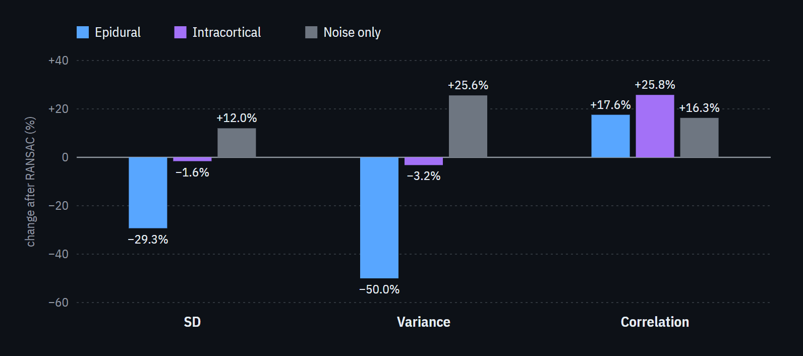

# Signal Reconstruction with RANSAC

[](https://nicaja.github.io/RANSAC-Intracranial-Recordings/)

*RANSAC step by step on the epidural µECoG grid: pick a few random contacts, predict the rest from them, correlate, repeat with new subsets, reject contacts that fail in more than 40% of epochs, and rebuild them. [Interactive version](https://nicaja.github.io/RANSAC-Intracranial-Recordings/), with the intracortical and noise-only examples.*

Research on bad-channel detection and interpolation in high-density epidural micro-ECoG and intracortical microelectrode-array recordings. The study examines how RANSAC's spatial assumptions affect reconstructed signals, and how its behaviour changes between surface and penetrating electrode arrays.

**Completed research project · IEEE EMBC 2025**

## Publication

**Strengths & Weaknesses of RANSAC applied to Epidural & Intracortical Recordings**

Nickolaj Ajay Atchuthan, Felipe Rettore Andreis, Winnie Jensen, and Suzan Meijs.

[Read the paper on IEEE Xplore](https://ieeexplore.ieee.org/document/11252752) · [DOI](https://doi.org/10.1109/EMBC58623.2025.11252752)

## What the study found

The work compared an epidural signal, an intracortical signal, and a noise-only example from experiments in anaesthetised pigs, with responses in the primary somatosensory cortex evoked by ulnar nerve stimulation. The epidural recordings used a 32-contact 8 × 4 µECoG grid placed on the dura (setup as in [Meijs et al., 2024](https://doi.org/10.1109/EMBC53108.2024.10782109)); the intracortical recordings used a 16-channel 4 × 4 microelectrode array with shafts 1 mm apart, inserted 2 mm into the cortex ([Janjua et al., 2021](https://doi.org/10.1016/j.ibneur.2021.08.004)). It used MNE and autoreject to examine changes in waveforms, spatial maps, variance, and reconstruction correlation.

- Tuned RANSAC settings improved the epidural example by detecting and interpolating faulty channels.
- The same settings could attenuate legitimate intracortical features. Default settings had only modest effects on the intracortical example.
- The noise-only example also became more correlated after interpolation. Higher correlation alone therefore did not demonstrate successful signal reconstruction.



*Values from Table II of the supplied manuscript. These describe the illustrated examples, not estimates of performance across a cohort.*

The main conclusion is that RANSAC needs modality-specific evaluation. Local activity in penetrating arrays can violate assumptions that are useful for more spatially correlated surface recordings. Signal preservation needs to be checked alongside noise reduction.

## Interactive figures

The [interactive page](https://nicaja.github.io/RANSAC-Intracranial-Recordings/) sketches the two arrays and walks through RANSAC on each example, as implemented in autoreject: sample a random subset of contacts, predict every contact from it, correlate each contact with its prediction, repeat with new subsets and keep the median prediction, reject contacts that fail in more than 40% of epochs, and rebuild them by interpolation.

The traces were digitised from the vector paths of the paper's figures. `docs/traces/build_data.py` maps every path back to seconds and microvolts using the figure axes, and assigns it to its electrode through MNE's spatial colours and the recorded montage. No recording is reanalysed. The sampling, prediction and correlation steps are replayed on the averaged response with a distance-weighted interpolation in place of autoreject's spherical splines, so their numbers are illustrative. The rejection step uses the paper's own per-epoch flags, and the rebuilt traces are the paper's RANSAC output. The [original figure PDFs and provenance](docs/figures/) are retained.

## Code and supporting material

| Path | Role |
| --- | --- |
| `research/ransac_comparison.py` | Portable comparison helper using the manuscript's parameter table |
| `preprocessing_ECoG/` | Historical preprocessing, RANSAC comparisons, and spatial mapping |
| `preprocessing_MEA/bad_channel_detection/` | Intracortical RANSAC and channel-quality experiments |
| `general/` | Recording-loading helpers |
| `docs/` | Interactive figures served by GitHub Pages |
| `docs/traces/` | Traces digitised from the manuscript figures, with the script that builds them |
| `docs/figures/` | Manuscript figures, reported values, and provenance |

The helper accepts already preprocessed MNE epochs with a reviewed electrode montage. It applies no implicit filtering, rescaling, or channel remapping. The `epidural-paper` preset uses 7 resamples, a 0.125 channel fraction, 0.85 correlation threshold, and 0.4 bad-epoch fraction, as listed in Table I. The `default` preset retains the paper's default settings.

```sh
python -m pip install -r requirements.txt
python -m research.ransac_comparison --help
python -m research.ransac_comparison recordings-epo.fif --preset epidural-paper --output outputs/comparison
python -m unittest discover -s tests -v
```

The original scripts preserve their run-specific paths and settings, including some 50-resample exploratory comparisons. The helper makes the paper's settings explicit; it does not recreate the original preprocessing or reproduce the publication without its recordings and montages. Tests use synthetic inputs and the digitised page data. Raw recordings are not included.

To rebuild the page data from the figure PDFs and preview the page locally:

```sh
python -m pip install pymupdf
python docs/traces/build_data.py
python -m http.server --directory docs
```
